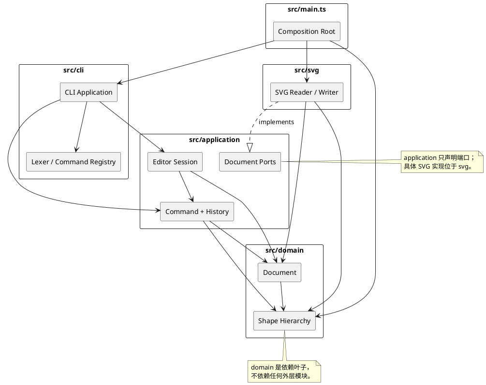

# SVG 命令行编辑器架构

## 1. 当前阶段与边界

当前处于 Lab1 Phase 1，本文件建立后续迭代共同遵守的架构契约。仓库当前只有 TypeScript 工程骨架、启动占位入口、测试骨架和文档；图形、命令、SVG IO 与 REPL 功能将在阶段 2–7 实现。

本阶段明确不做以下工作：

- 不实现 `box` 插件或任何插件注册机制的具体代码。
- 不提前实现图形领域模型、编辑命令、SVG 读写或交互式 REPL。
- 不把课程示例输出写成已通过的测试结果。

功能验收契约见 [`Phase1AcceptanceChecklist.md`](Phase1AcceptanceChecklist.md)。

## 2. 架构方案

### 2.1 分层与模块职责

计划目录如下：

```text
src/
├── domain/
│   ├── Document.ts
│   ├── Shape.ts
│   └── shapes/
│       ├── StyledShape.ts
│       ├── RectShape.ts
│       ├── CircleShape.ts
│       ├── EllipseShape.ts
│       ├── LineShape.ts
│       ├── TextShape.ts
│       └── GroupShape.ts
├── application/
│   ├── EditorSession.ts
│   ├── CommandHistory.ts
│   ├── DocumentSnapshot.ts
│   └── commands/
│       ├── EditorCommand.ts
│       ├── UndoableEditCommand.ts
│       └── ...各编辑与文档命令
├── svg/
│   ├── SvgDocumentReader.ts
│   └── SvgDocumentWriter.ts
├── cli/
│   ├── CliApplication.ts
│   ├── CommandLexer.ts
│   └── CommandRegistry.ts
└── main.ts

tests/
├── domain/
├── application/
├── svg/
└── cli/
```

各模块职责：

| 模块 | 职责 | 禁止事项 |
|---|---|---|
| `domain` | 画布、图形类层次、Composite 层级、几何与属性规则、ID 查找 | 不读文件、不打印、不解析 CLI、不导入外层模块 |
| `application` | 会话状态、命令对象、undo/redo 历史、SVG 端口接口、错误分类 | 不直接访问控制台；不依赖具体 XML 库 |
| `svg` | SVG 与领域文档的双向转换、缺失 ID 补全、XML 错误归一化 | 不解析 CLI 命令；不绕过领域封装直接改数据 |
| `cli` | 词法分析、语法解析、命令名注册与分发、文本输出 | 不放几何、层级或历史业务规则 |
| `main.ts` | Composition Root：组装具体实现并启动 CLI | 不承载业务逻辑 |

### 2.2 组件/包依赖图



### 2.3 依赖方向规则

允许的依赖：

1. `domain` 只能依赖 TypeScript 标准库和自身内部模块。
2. `application` 可以依赖 `domain`，不能依赖 `svg` 或 `cli` 的具体实现。
3. `svg` 可以依赖 `domain`，并可实现 `application` 声明的端口。
4. `cli` 可以依赖 `application`，不能直接修改领域对象。
5. `main.ts` 是唯一 Composition Root，可以依赖全部模块以完成注入和启动。
6. 测试可以依赖被测模块和测试辅助代码，但测试辅助代码不得成为生产依赖。

这样安排的原因是：领域规则不知道文件、终端或 XML；IO 和交互可以替换而无需修改图形模型；CLI 的语法变化不会蔓延到文档模型。出现反向导入即记为架构违规并在后续阶段修正。

### 2.4 图形类层次与 Composite 语义

`Shape` 是统一抽象基类，封装 `id`、父容器、`move`、`scale`、`setAttribute` 和显示/序列化访问者入口。具体叶类继承它：

- `RectShape`、`CircleShape`、`EllipseShape`、`LineShape`、`TextShape` 分别封装自己的强类型几何字段和白名单属性。
- `GroupShape` 同样继承 `Shape`，额外持有有序子项集合，并递归实现 `move`/`scale`。
- `Document` 表示 SVG 根画布，持有宽高和顶层有序图形，不等同于普通 `<g>`，也不暴露可修改的公共数据袋。

调用方只面向 `Shape`：

```text
move(id, dx, dy)  -> shape.move(dx, dy)
scale(id, factor) -> shape.scale(factor)
set(id, attr, v)  -> shape.setAttribute(attr, v)
```

这样叶子与容器在命令层具有一致语义。`GroupShape` 的 `move`/`scale` 通过多态递归子项，不需要在命令中写 `if (shape is group)`。删除、插入、重排由父级 Composite 的封装 API 完成；命令层负责先验证、再原子执行。

各具体图形实现 `accept(visitor)`，由子类调用对应访问方法。树形显示、属性明细和 SVG 序列化使用不同访问者，以双重分派替代 `switch(tag)`。按名称创建图形的映射集中在 `ShapeFactory`，这是课程允许的“图形工厂”分派点。

### 2.5 Command 模式与历史

每条编辑命令是一个对象，至少包含：

```text
EditorCommand
├── execute(context)
├── undo()
└── redo()
```

设计约定：

- `UndoableEditCommand` 采用模板方法：先验证，再执行领域操作，最后形成可恢复状态。失败时不留下部分修改。
- `CommandHistory` 维护 undo/redo 两个栈；一条用户命令对应一个对象，所以复杂 `group` 也自然成为一个原子 undo 单元。
- 命令通过 `DocumentSnapshot`（Memento）记录执行前后的完整文档状态。相比为十几种命令分别编写逆操作，它对删除、重排、跨容器移动和后续插件内部结构更稳健，也更容易保证错误原子性。
- 代价是每步保存整份文档，时间/空间复杂度为 O(文档大小)。本课程文档规模较小，这一取舍优先保证正确性与扩展性；若未来文档变大，可在 `Command` 接口不变的前提下换成结构化补丁。
- 显示命令不进入历史。文档命令和 `canvas` 尺寸修改会清空历史并设置 IO 屏障；下一次成功编辑解除屏障，但不会恢复跨越 IO 的旧历史。
- 命令的“成功”以领域操作全部完成且结果可生成为准。解析失败、验证失败和 IO 失败都不入栈、不清空 redo，也不改变文档。

命令名 `Map<string, CommandFactory>` 只在 `CommandRegistry` 中做名称到实现的查找；图形类型名只由 `ShapeFactory` 负责。除这两处外不按字符串标签写分支。

### 2.6 SVG 端口与适配

`application` 声明类似以下端口，具体签名在阶段 6 依据实际模型定型：

```text
DocumentReader.read(path): ReadResult
DocumentWriter.write(document, path): void
```

`svg` 模块实现这些端口。读取时先构建完整候选文档并分配缺失 ID，全部成功后才替换当前文档；警告随结果返回给 CLI 输出。写入通过具体图形的序列化访问者组装 XML，避免在 Writer 中堆积类型判断。这样非法文件不会留下半完成文档。

### 2.7 错误模型与状态不变性

领域和应用层使用有语义的错误类型，例如非法参数、未找到、重复 ID、层级循环、IO 屏障。CLI 最外层统一映射为规定的一行 `error: ...` 文本。

每个命令遵循“验证 → 生成候选状态 → 提交”的顺序。任何验证或执行异常都不会提交候选状态，因此输入错误时文档、当前选中状态和历史栈保持不变。

## 3. 变化点与预留策略

| 可能变化 | 影响位置 | 当前策略/理由 |
|---|---|---|
| 增加 `box` 等复合图形插件 | 插件注册、图形模板、序列化标记 | 内核面向 `Shape`/Composite 语义；Phase 1 不提前实现插件。后续由 ShapeProvider 扩展，不修改命令调用方 |
| 新增基础图形类型 | `ShapeFactory`、具体 Shape、显示/序列化访问者 | 保留类层次和双重分派；新增形状的影响局限在工厂与访问者实现。插件阶段不应依赖这条路径扩展 |
| Command 增加操作类型 | `application/commands`、命令注册表 | 一条命令一个类，历史只面向统一接口，无需修改 `CommandHistory` |
| 文档规模增大，快照成本过高 | `DocumentSnapshot` 及命令基类 | 保持 Command API，替换为增量 Memento；当前不为小文档过度设计 diff 引擎 |
| SVG 语法或第三方 XML 库变化 | `svg` 适配器 | 领域不依赖 XML DOM；端口隔离具体库和格式细节 |
| CLI 语法扩展 | lexer/parser/command registry | 解析、分派和业务执行分离；语法变化不进入 domain |
| 修改历史策略或 IO 限制 | `CommandHistory`、文档命令 | 历史策略集中，不散落在各命令或 CLI |
| 图形新增可编辑属性 | 对应具体 Shape 的白名单实现 | 属性语义由类型自身多态处理，不在全局写大分支 |
| 后续需要持久化扩展状态 | DocumentSnapshot 与 SVG 属性 | 快照封装完整领域状态；扩展标记需同时补读回测试 |

暂不预留的部分：

- 不为尚未定义的插件加载格式创建空接口或空目录，避免“为了模式而模式”的死抽象。
- 不实现多用户并发编辑和持久化数据库，课程仅要求单进程 CLI。
- 不提前优化大文档 undo 性能；先以可验证的原子快照保证正确性。

## 4. 过程记录

### 轮次 1：需求提取与阶段边界（2026-10-23）

- 实际请求指向 `requirements/phase_cli_1.md`，工作区中的完整需求文件实际位于根目录 `phase_cli_1.md`；已完整读取根目录文件并核对要求截图。没有虚构不存在的路径。
- 初稿倾向逐命令编写逆操作。复核 `group`、`ungroup`、递归 `scale`、删除整棵子树以及未来插件结构后，逆操作数量多且容易在异常路径产生部分回滚。
- 改为 Command 模式与 DocumentSnapshot Memento 协作：每条命令仍是独立对象和历史单元，但恢复逻辑统一、原子性更易验证。记录其 O(n) 快照成本作为后续可替换点。
- 明确 `switch(tag)` 不是唯一问题，字符串分派必须收口到命令注册表和图形工厂两处；其他位置使用多态和访问者。
- 明确第一阶段绝不实现 `box`，避免把后续插件能力提前固化进内核。

### 轮次 2：工程初始化与环境问题（2026-10-23）

- 工作区初始只有需求 Markdown 和截图，不是 Git 仓库；系统 `PATH` 中也找不到 Git。
- 先尝试 Winget 安装 Git，下载 GitHub 安装包时报 `InternetOpenUrl() failed 0x80072efd`。没有把失败写成成功；随后从国内镜像取得官方 MinGit 2.55.0 的便携包，放入用户程序目录并加入用户 `PATH`。
- 建立严格 TypeScript 配置，选择 Vitest 作为测试运行器，并提供构建、测试和 CLI 启动脚本。
- 第一阶段测试只验证工程契约和目录骨架。功能测试会在对应实现阶段加入，避免空测试伪造覆盖率。
- 系统未配置 Git 作者身份。为避免冒用用户身份，本仓库仅在本地配置了明确的智能体提交身份；用户如希望使用个人身份，可在后续提交前修改本地 `user.name`/`user.email`。

## 5. 一致性自查

本节在每个开发阶段结束时更新；Phase 1 状态如下。

1. 模块划分：实际已建立 `domain`、`application`、`svg`、`cli` 的目录骨架，计划中的具体类尚未实现。没有不一致项。
2. 依赖方向：当前生产代码只有 `main.ts` 依赖 `AppInfo`。`domain`、`application`、`svg`、`cli` 尚无实现，因此本阶段不存在反向依赖；后续以导入路径和架构测试持续检查。

## 6. 质量保证手段

阶段 1 的验证命令：

```text
npm install
npm run build
npm test
npm run cli
git diff --check
git status --short
```

第一阶段测试覆盖：npm 脚本契约、计划目录存在性、应用标识类可实例化。功能验收项均明确标记为后续阶段，不计算为已完成。

后续质量门槛：领域单元测试覆盖类型与 Composite；命令测试覆盖原子性和历史；SVG 测试覆盖解析、警告与 round-trip；CLI 集成测试回放课程 transcript。最终报告中记录真实命令输出、提交 hash 和未覆盖风险。

### Phase 1 实际验证结果（2026-10-23）

| 命令 | 结果 |
|---|---|
| `npm install --no-audit --no-fund` | 成功安装 55 个包并生成 `package-lock.json` |
| `npm run build` | 退出码 0，TypeScript 无诊断 |
| `npm test` | 1 个测试文件、3 个测试全部通过 |
| `npm run cli` | 退出码 0，输出 `svg-editor 0.1` 和 Phase 1 占位提示 |
| `git diff --check`（暂存后执行 `--cached --check`） | 提交前检查空白错误 |

上述测试只证明 Phase 1 工程契约，不证明图形编辑、命令历史或 SVG IO 已实现。
