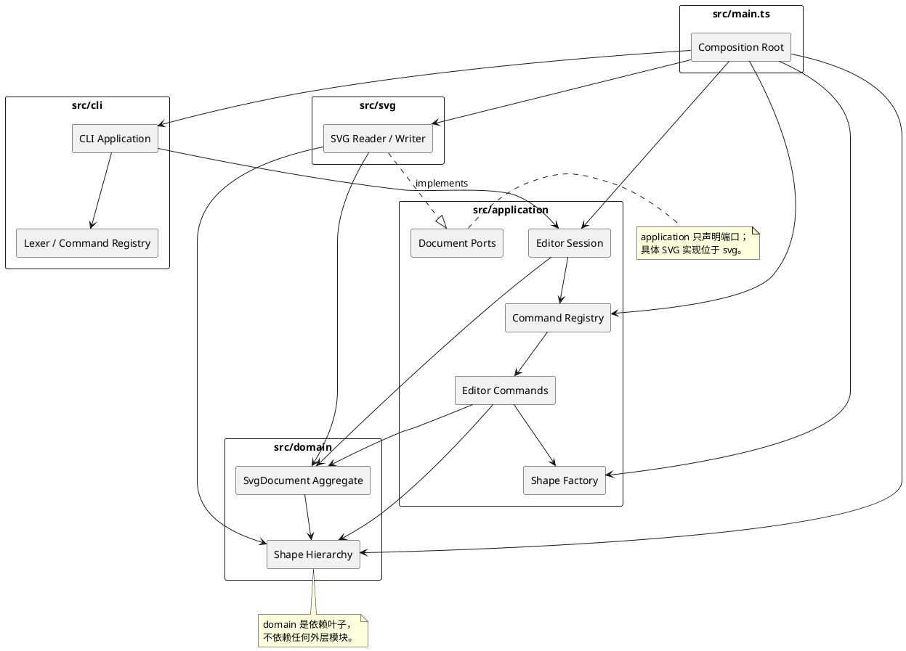

# SVG 命令行编辑器架构

## 1. 当前阶段与边界

当前已完成 Lab1 Phase 4，本文件记录图形模型接入命令、REPL 以及组合/层级操作后的实际结构。仓库现在支持基础编辑命令与 `group/ungroup/addto/front/back`；CommandHistory、IO 和显示类命令仍将在后续阶段实现。

后续阶段才做的工作：

- 不实现 `box` 插件或任何插件注册机制的具体代码。
- 不实现 CommandHistory、Memento、undo/redo、SVG 读写或显示类命令。
- 不把课程示例输出写成已通过的测试结果。

功能验收契约见 [`Phase1AcceptanceChecklist.md`](Phase1AcceptanceChecklist.md)。

## 2. 架构方案

### 2.1 分层与模块职责

计划目录如下：

```text
src/
├── domain/
│   ├── SvgDocument.ts
│   ├── Shape.ts
│   ├── ShapeVisitor.ts
│   ├── DomainError.ts
│   └── shapes/
│       ├── StyledShape.ts
│       ├── RectShape.ts
│       ├── CircleShape.ts
│       ├── EllipseShape.ts
│       ├── LineShape.ts
│       ├── TextShape.ts
│       └── GroupShape.ts
├── application/
│   ├── EditorSession.ts
│   ├── CommandRegistry.ts
│   ├── CommandArguments.ts
│   ├── EditorCommand.ts
│   ├── ShapeFactory.ts
│   ├── ShapeTypeNameVisitor.ts
│   ├── ApplicationError.ts
│   └── commands/
│       ├── InitCommand.ts
│       ├── CreateShapeCommand.ts
│       ├── DeleteShapeCommand.ts
│       ├── MoveShapeCommand.ts
│       ├── ScaleShapeCommand.ts
│       ├── SetAttributeCommand.ts
│       ├── GroupCommand.ts
│       ├── UngroupCommand.ts
│       ├── AddToGroupCommand.ts
│       ├── FrontCommand.ts
│       ├── BackCommand.ts
│       └── HelpCommand.ts
├── svg/
│   ├── SvgDocumentReader.ts
│   └── SvgDocumentWriter.ts
├── cli/
│   ├── CliApplication.ts
│   ├── CommandLexer.ts
│   └── CliParsingError.ts
└── main.ts

tests/
├── domain/
├── application/
└── cli/
```

各模块职责：

| 模块 | 职责 | 禁止事项 |
|---|---|---|
| `domain` | 画布、图形类层次、Composite 层级、几何与属性规则、ID 查找 | 不读文件、不打印、不解析 CLI、不导入外层模块 |
| `application` | 会话状态、命令对象、undo/redo 历史、SVG 端口接口、错误分类 | 不直接访问控制台；不依赖具体 XML 库 |
| `svg` | SVG 与领域文档的双向转换、缺失 ID 补全、XML 错误归一化 | 不解析 CLI 命令；不绕过领域封装直接改数据 |
| `cli` | 词法分析、语法解析、命令名注册与分发、文本输出 | 不放几何、层级或历史业务规则 |
| `main.ts` | Composition Root：组装具体实现并启动 CLI | 不承载业务逻辑 |

Phase 2 实际领域文件与上表的对应关系：

- 原计划名 `Document.ts` 按第二阶段任务改名为 `SvgDocument.ts`，类名保持一致，避免与运行时全局 `Document` 概念混淆。
- 新增 `DomainError.ts` 统一表达重复 ID、非法数值、层级循环等领域失败。
- 新增 `ShapeVisitor.ts` 作为双重分派契约；具体访问者留到显示和 SVG 序列化阶段实现。
- `StyledShape.ts` 封装 `fill`、`stroke`、`stroke-width`，被五种叶子和 `GroupShape` 共同继承。

Phase 3 实际应用/CLI 结构：

- `EditorSession` 持有当前 `SvgDocument`，并向命令提供文档、图形和容器查询，是 CLI 的唯一应用入口。
- `CommandRegistry` 集中完成命令名分派；每个命令类独立处理自己的参数和业务编排。
- `ShapeFactory` 集中完成图形类型名到构造器的映射，且不包含 `box`。
- `CommandLexer` 只处理空行、注释、空白和双引号；`CliApplication` 负责提示符、逐行读取、错误文本和输出流。

### 2.2 组件/包依赖图



### 2.3 依赖方向规则

允许的依赖：

1. `domain` 只能依赖 TypeScript 标准库和自身内部模块。
2. `application` 可以依赖 `domain`，不能依赖 `svg` 或 `cli` 的具体实现。
3. `svg` 可以依赖 `domain`，并可实现 `application` 声明的端口。
4. `cli` 可以依赖 `application`，不能直接修改领域对象。
5. `main.ts` 是唯一 Composition Root，可以依赖全部模块以完成注入和启动。
6. 测试可以依赖被测模块和测试辅助代码，但测试辅助代码不得成为生产依赖。

这样安排的原因是：领域规则不知道文件、终端或 XML；IO 和交互可以替换而无需修改图形模型；CLI 的语法变化不会蔓延到文档模型。出现反向导入即记为架构违规并在后续阶段修正。

### 2.4 图形类层次与 Composite 语义

`Shape` 是统一抽象基类，封装 `id`、`move`、`scale`、`setAttribute`、子节点统一访问和显示/序列化访问者入口。具体叶类继承它：

- `RectShape`、`CircleShape`、`EllipseShape`、`LineShape`、`TextShape` 分别封装自己的强类型几何字段和白名单属性。
- `GroupShape` 同样继承 `Shape`，额外持有有序子项集合，并递归实现 `move`/`scale`。
- `SvgDocument` 表示 SVG 根画布，持有宽高和顶层有序图形，不等同于普通 `<g>`，也不暴露可修改的公共数据袋。

父子关系由 `SvgDocument` 的私有映射集中维护，而不是让每个图形各自保存一个可被任意改写的 parent 字段。这样添加整棵子树时可以一次性完成全局 ID 和父子关系校验，删除时也能准确清理全部索引。`GroupShape` 自身仍通过公开只读快照暴露子项，并负责防止局部父子循环。

Phase 4 对树结构修改增加了所有权约束：

- 未加入文档的 Group 可用 `appendChild/removeChild` 组装独立子树，保持原有构建接口。
- Group 注册到 `SvgDocument` 后由文档标记为 managed；公开 `appendChild/removeChild` 会拒绝直接修改，避免图形树与 `_shapesById/_parentsById` 脱节。
- `SvgDocument` 使用不可从外部获得的私有 capability token 调用受控领域内部入口，完成已入档子树的插入、移除和重排；Application 命令只调用 `groupShapes/ungroupShape/addShapeToGroup/bringToFront/sendToBack` 五个聚合 API。外部即使知道内部方法名，没有 token 也不能修改 managed Group。

调用方只面向 `Shape`：

```text
move(id, dx, dy)  -> shape.move(dx, dy)
scale(id, factor) -> shape.scale(factor)
set(id, attr, v)  -> shape.setAttribute(attr, v)
```

这样叶子与容器在命令层具有一致语义。`GroupShape` 的 `move`/`scale` 通过多态递归子项，不需要在命令中写 `if (shape is group)`。删除、插入、重排由父级 Composite 的封装 API 完成；命令层负责先验证、再原子执行。

各具体图形实现 `accept(visitor)`，由子类调用对应访问方法。树形显示、属性明细和 SVG 序列化使用不同访问者，以双重分派替代 `switch(tag)`。按名称创建图形的映射集中在 `ShapeFactory`，这是课程允许的“图形工厂”分派点。

`GroupShape` 的内部追加入口在修改前检查直接自包含和间接循环。`SvgDocument.addShape` 在修改树之前预检目标父容器、候选子树内部重复 ID、与文档已有 ID 的冲突以及跨子树循环；失败时文档根列表和两个索引均不改变。

统一结构 API 与语义：

| API | 结构语义 |
|---|---|
| `groupShapes(newId, members)` | 成员按当前文档树前序（SVG 绘制顺序）排列；同父时插入在原首个成员位置，跨父时新 Group 追加到根末尾 |
| `ungroupShape(groupId)` | 仅允许嵌套 Group；直接子项按原顺序替换 Group 的原位置，根级 Group 拒绝 |
| `addShapeToGroup(groupId, shapeId)` | 原地移动同一对象和整个子树，追加为目标 Group 最后一个子项；已在末尾时无操作 |
| `bringToFront(id)` | 只调整当前父容器内的兄弟顺序 |
| `sendToBack(id)` | 只调整当前父容器内的兄弟顺序 |

### 2.5 Command 模式与历史

每条命令是一个独立对象，实现统一的 `EditorCommand` 接口：

```text
EditorCommand
├── name / usage / description
└── execute(context, args)
```

Phase 3–4 已落地 `InitCommand`、`CreateShapeCommand`、`DeleteShapeCommand`、`MoveShapeCommand`、`ScaleShapeCommand`、`SetAttributeCommand`、`GroupCommand`、`UngroupCommand`、`AddToGroupCommand`、`FrontCommand`、`BackCommand` 和 `HelpCommand`。`CommandRegistry` 是唯一按命令名分派的入口，`ShapeFactory` 是唯一按图形类型创建实例的位置。两者都是课程允许的字符串分派集中点。

调用链为：

```text
CliApplication
  -> EditorSession.execute(commandName, tokens)
  -> CommandRegistry
  -> concrete EditorCommand
  -> SvgDocument / Shape polymorphic operations
```

CLI 只负责词法分析和文本 I/O；参数个数、类型、容器存在性等命令语法由 application 命令处理；几何和层级规则仍由 domain 处理。`EditorSession` 是当前工作文档和命令执行的单一入口，不会解析具体命令语法。

为第五阶段 undo/redo 预留的方式：

- CLI 与 `CommandExecutor` 接口无需改变；历史逻辑可以插入 `EditorSession.execute` 的统一事务边界。
- 每个编辑命令已独立成类，后续可引入 `UndoableCommand` 扩展接口，而不把撤销逻辑散落到各命令或 CLI。
- Memento 可以围绕一次成功的 registry dispatch 捕获文档前后状态；失败 dispatch 不进入历史。
- 当前命令对象无状态，参数由每次调用传入，避免不同执行之间复用可变命令实例状态。

后续阶段设计约定：

- `UndoableEditCommand` 采用模板方法：先验证，再执行领域操作，最后形成可恢复状态。失败时不留下部分修改。
- `CommandHistory` 维护 undo/redo 两个栈；一条用户命令对应一个历史单元。
- 命令通过 `DocumentSnapshot`（Memento）记录执行前后的完整文档状态。相比为十几种命令分别编写逆操作，它对删除、重排、跨容器移动和后续插件内部结构更稳健，也更容易保证错误原子性。
- 代价是每步保存整份文档，时间/空间复杂度为 O(文档大小)。本课程文档规模较小，这一取舍优先保证正确性与扩展性；若未来文档变大，可在 `Command` 接口不变的前提下换成结构化补丁。
- 显示命令不进入历史。文档命令和 `canvas` 尺寸修改会清空历史并设置 IO 屏障；下一次成功编辑解除屏障，但不会恢复跨越 IO 的旧历史。
- 命令的“成功”以领域操作全部完成且结果可生成为准。解析失败、验证失败和 IO 失败都不入栈、不清空 redo，也不改变文档。

命令名 `Map<string, EditorCommand>` 只在 `CommandRegistry` 中做名称到实现的查找；图形类型名只由 `ShapeFactory` 负责。除这两处外没有按字符串标签执行的图形分派。

### 2.6 SVG 端口与适配

`application` 声明类似以下端口，具体签名在阶段 6 依据实际模型定型：

```text
DocumentReader.read(path): ReadResult
DocumentWriter.write(document, path): void
```

`svg` 模块实现这些端口。读取时先构建完整候选文档并分配缺失 ID，全部成功后才替换当前文档；警告随结果返回给 CLI 输出。写入通过具体图形的序列化访问者组装 XML，避免在 Writer 中堆积类型判断。这样非法文件不会留下半完成文档。

### 2.7 错误模型与状态不变性

领域和应用层使用有语义的错误类型，例如非法参数、未找到、重复 ID、层级循环、IO 屏障。CLI 最外层统一映射为规定的一行 `error: ...` 文本。

每个命令遵循“验证 → 生成候选状态 → 提交”的顺序。任何验证或执行异常都不会提交候选状态，因此输入错误时文档、当前选中状态和历史栈保持不变。

Phase 2 已实现 `DomainError.code` 和稳定的领域错误消息。当前覆盖非法 ID、非法数字、非正缩放因子、未知属性、重复 ID、未找到图形、非法父节点、层级循环和非法画布尺寸；Phase 3 完成了 CLI 文本映射。

Phase 3 新增 `ApplicationError` 表达无文档、未知命令、参数用法和未知图形类型，并在 `EditorSession` 边界把 `DomainError` 归一为应用错误。CLI 统一输出 `error: <message>`，因此 REPL 不需要导入领域层。失败命令不替换文档，也不会让 REPL 退出。

领域为“缩放溢出”增加了无副作用的 `assertCanScale` 预检：叶子验证全部缩放结果有限，Group 先递归验证所有后代再开始修改。这样超大但有限的 factor 导致中间值溢出时，不会留下部分缩放状态。

Phase 4 同时增加 `assertCanMove`：所有叶子预检移动后的全部坐标有限，Group 递归预检整棵子树后才执行移动。极大有限坐标与极大有限偏移导致 `Infinity` 时抛出 `NUMERIC_OVERFLOW`，已有子项不会先被移动。

已入档 Group 的公开树修改会抛出 `INVALID_TREE_MUTATION`，要求外部通过 `SvgDocument` 的结构 API。该错误与 `INVALID_STRUCTURE_OPERATION` 一起保证 Application 不会绕过索引。

## 3. 变化点与预留策略

| 可能变化 | 影响位置 | 当前策略/理由 |
|---|---|---|
| 增加 `box` 等复合图形插件 | 插件注册、图形模板、序列化标记 | 内核面向 `Shape`/Composite 语义；当前不提前实现插件。后续由 ShapeProvider 扩展，不修改命令调用方 |
| 新增基础图形类型 | `ShapeFactory`、具体 Shape、显示/序列化访问者 | 保留类层次和双重分派；新增形状的影响局限在工厂与访问者实现。插件阶段不应依赖这条路径扩展 |
| Command 增加操作类型 | `application/commands`、命令注册表 | 一条命令一个类，历史只面向统一接口，无需修改 `CommandHistory` |
| 文档规模增大，快照成本过高 | `DocumentSnapshot` 及命令基类 | 保持 Command API，替换为增量 Memento；当前不为小文档过度设计 diff 引擎 |
| SVG 语法或第三方 XML 库变化 | `svg` 适配器 | 领域不依赖 XML DOM；端口隔离具体库和格式细节 |
| CLI 语法扩展 | lexer/parser/command registry | 解析、分派和业务执行分离；语法变化不进入 domain |
| 修改历史策略或 IO 限制 | `CommandHistory`、文档命令 | 历史策略集中，不散落在各命令或 CLI |
| 图形新增可编辑属性 | 对应具体 Shape 的白名单实现 | 属性语义由类型自身多态处理，不在全局写大分支 |
| 后续需要持久化扩展状态 | DocumentSnapshot 与 SVG 属性 | 快照封装完整领域状态；扩展标记需同时补读回测试 |
| 新增组合/层级命令 | `SvgDocument` 结构 API + 新 EditorCommand | 验证、索引维护和提交集中；Application 只做参数和结果编排 |
| 图形类型增加容器变体 | `GroupShape`/Shape 契约 + 访问者 | 统一树结构操作留在 domain；插件不应直接操作文档索引 |
| 兄弟顺序规则变化 | `SvgDocument` 的排序/插入辅助方法 | 使用真实兄弟数组，不引入额外 zIndex 状态 |

暂不预留的部分：

- 不为尚未定义的插件加载格式创建空接口或空目录，避免“为了模式而模式”的死抽象。
- 不实现多用户并发编辑和持久化数据库，课程仅要求单进程 CLI。
- 不提前优化大文档 undo 性能；先以可验证的原子快照保证正确性。

## 4. 过程记录

### 轮次 1：需求提取与阶段边界（2026-10-23）

- 实际请求指向 `requirements/phase_cli_1.md`，工作区中的完整需求文件实际位于根目录 `phase_cli_1.md`；已完整读取根目录文件并核对要求截图。没有虚构不存在的路径。
- 初稿倾向逐命令编写逆操作。复核 `group`、`ungroup`、递归 `scale`、删除整棵子树以及未来插件结构后，逆操作数量多且容易在异常路径产生部分回滚。
- 改为 Command 模式与 DocumentSnapshot Memento 协作：每条命令仍是独立对象和历史单元，但恢复逻辑统一、原子性更易验证。记录其 O(n) 快照成本作为后续可替换点。
- 明确 `switch(tag)` 不是唯一问题，字符串分派必须收口到命令注册表和图形工厂两处；其他位置使用多态和访问者。
- 明确第一阶段绝不实现 `box`，避免把后续插件能力提前固化进内核。

### 轮次 2：工程初始化与环境问题（2026-10-23）

- 工作区初始只有需求 Markdown 和截图，不是 Git 仓库；系统 `PATH` 中也找不到 Git。
- 先尝试 Winget 安装 Git，下载 GitHub 安装包时报 `InternetOpenUrl() failed 0x80072efd`。没有把失败写成成功；随后从国内镜像取得官方 MinGit 2.55.0 的便携包，放入用户程序目录并加入用户 `PATH`。
- 建立严格 TypeScript 配置，选择 Vitest 作为测试运行器，并提供构建、测试和 CLI 启动脚本。
- 第一阶段测试只验证工程契约和目录骨架。功能测试会在对应实现阶段加入，避免空测试伪造覆盖率。
- 系统未配置 Git 作者身份。为避免冒用用户身份，本仓库仅在本地配置了明确的智能体提交身份；用户如希望使用个人身份，可在后续提交前修改本地 `user.name`/`user.email`。

### 轮次 3：第二阶段领域模型首轮实现（2026-10-23）

- 从 Phase 1 基线 `e1f1633` 开始，确认工作区干净且本地与远程一致；没有重新初始化 Git，也没有改写提交历史。
- 采用 `Shape -> StyledShape -> 五种叶子/GroupShape` 的继承层次。所有几何字段为私有字段，只通过只读 getter 和类型自身的 `setAttribute` 白名单修改。
- `move` 与 `scale` 在修改前验证参数。`GroupShape` 先验证一次参数，再通过 `Shape` 多态递归子项，命令层无需再判断容器类型。
- `SvgDocument` 采用 `Map<string, Shape>` 和 `Map<string, Shape | null>` 分别维护大小写敏感的 ID 索引和父子关系；根节点顺序使用独立有序数组。
- 父关系没有存放为 `Shape.parent` 可写字段，而是集中存于 `SvgDocument` 私有索引。代价是图形对象脱离文档后不携带父信息，收益是全局唯一性和整树增删能够原子提交。
- 组样式语义初稿存在“递归改子项”和“仅设置 g 自身”两种选择。需求只要求容器的 move/scale 递归；因此采用 SVG 标准语义，仅设置 `g` 容器自身样式，由 SVG 继承规则影响未显式覆盖的后代，不在领域层强制覆盖子项样式。

首轮代码完成后，`npm run build` 通过，Vitest 为 6 个测试文件、33 项测试通过。

### 轮次 4：自审与纠正（2026-10-23）

- 自审代码时发现 `SvgDocument` 构造函数通过 `Shape["parsePositiveNumber"]` 绕过 `protected` 限制完成画布尺寸校验。该写法可以编译，但依赖 TypeScript 的索引访问绕过访问控制，违背字段封装和清晰依赖的目标。已改为 `SvgDocument` 自己持有的私有画布尺寸校验方法。
- 增加全项目 `npx tsc -p tsconfig.json --noEmit` 检查，发现 `SvgDocument.test.ts` 有未使用的 `DomainError` 导入。Vitest 转译不报此问题，严格类型检查会失败；删除导入后重新验证通过。
- 同时补充访问者多态测试、非有限 movement 的原子性测试和“领域层没有 `box` 文件/关键字”的架构测试。最终测试为 36 项，其中 33 项为领域行为/架构测试，3 项为原有工程 scaffold 测试。
- 全程未修改 `application`、`svg`、`cli` 或入口文件，第二阶段改动范围保持在领域层与对应测试/文档内。

### 轮次 5：领域接入 CLI 前的接口审查（2026-10-23）

- 逐项检查现有 `Shape`、`SvgDocument` 和测试后，确认创建、删除、查询、父子关系和递归操作已有足够接口，不重写领域图形逻辑。
- 发现现有 `scale` 只验证 factor 本身，极大但仍有限的 factor 可能把坐标或尺寸乘成 `Infinity`；Group 逐子项缩放还可能出现前几个子项成功、后一个失败的部分修改。
- 最小修改领域：为 `Shape` 增加公开的无副作用缩放预检契约 `assertCanScale`，叶子预计算并检查所有缩放结果，Group 递归预检全部后代后才执行缩放。新增 `NUMERIC_OVERFLOW` 领域错误。
- 该修改保持 Shape 多态调用不变，应用 `scale` 命令仍只调用 `shape.scale(factor)`，不增加类型分支。

### 轮次 6：应用层首轮实现与编译纠正（2026-10-23）

- 按职责新增 `CommandRegistry`、`ShapeFactory`、`EditorSession`、命令上下文/结果/接口，以及七个独立命令类；CLI 新增词法器、解析错误和 REPL。
- 初次编译失败：多个命令类错误地把局部变量命名为 `arguments`，严格模式类体禁止该标识符；同时可选数组索引在 `rejectUsage()` 后未稳定收窄，产生字符串可能为 `undefined` 的错误。
- 纠正为 `commandArguments` 命名，并在 `CommandArguments` 中新增 `required(index): string`，统一完成索引校验和类型收窄。随后 `npm run build` 与全项目类型检查通过。
- 实现前自审发现容器判断最初计划用“是否存在 `appendChild/children`”做结构探测，叶子也满足这些成员，会误判；改为仅在应用边界查询容器时使用 `shape instanceof GroupShape`。几何操作仍未按类型分支。

### 轮次 7：自动化测试失败与纠正（2026-10-23）

- 首次运行应用与 CLI 测试：11 个测试文件、64 项中 63 项通过。失败项是“连续命令”测试把初始宽度 100 经 2 倍缩放后的期望误写为 400，实际正确值为 200。
- 全项目类型检查同时发现测试误调用不存在的 `SvgDocument.findRoot`；该调用只是冗余状态断言，删除后以对象身份不变验证替代。
- 修正的是测试期望和测试代码，而不是为了让错误断言通过而修改业务实现。修正后 11 个文件、64 项全部通过。
- 新增测试覆盖六种创建、`in` 容器、ID/容器/类型错误、参数错误、move/scale/set/delete、嵌套 Group、失败状态不变、连续命令、无文档、未知命令、词法解析、真实流式 REPL、依赖隔离和缩放溢出原子性。

### 轮次 8：手动验收与架构影响（2026-10-23）

- 通过 `npm run cli` 管道实际回放课程正常序列；启动行、提示符、创建、移动、缩放、属性修改、删除和 help 输出均符合本阶段范围。
- 在同一文档上继续执行重复 ID、负宽度、缺失图形、`scale 0`、`hexagon` 五类错误，全部输出 `error:`；随后 `set r1 fill blue` 成功，证明 REPL 未退出且原文档仍可编辑。
- `git diff` 范围分为：domain 的缩放预检及测试、application 命令体系、cli 解析/REPL、`main.ts` 组装和文档。没有修改 `svg` 模块，也没有提前实现 tree/show/save/undo。
- 依赖检查：domain 无外层导入；application 不导入 CLI、SVG 或 Node API；CLI 不直接导入 domain，只依赖应用的 `CommandExecutor` 与错误文本。

### 轮次 9：第四阶段前置问题复现（2026-10-23）

- 人工审查提出两个风险后，先新增 `treeInvariant.test.ts`，没有先改实现。测试直接调用已入档 `GroupShape.appendChild/removeChild`，并用嵌套 Group 的第一个安全、第二个溢出的移动场景验证原子性。
- 首轮运行 3 项测试全部失败：直接增删确实成功；极大有限偏移把后一个子项变成 `Infinity`，且前一个子项已经被移动。这证明两个问题都真实存在，而非仅理论风险。
- 结构修复采用 managed 所有权约束：未入档 Group 保留原有 append/remove 构建能力；进入文档后公开修改被拒绝，`SvgDocument` 通过受控内部入口维护两个索引。回归测试验证直接修改失败时根顺序、父关系和 ID 索引均不变。
- 移动修复增加 `assertCanMove` 和 `movedValue`。叶子先计算全部新坐标并验证有限，嵌套 Group 先递归验证整棵树，再执行实际移动。原 3 项回归测试随后全部通过。

### 轮次 10：组合与排序结构 API（2026-10-23）

- 设计初稿只考虑同父节点分组，无法满足课程允许跨父容器分组的要求。最终明确策略：同父时在最早原成员位置插入新 Group；跨父时把新 Group 追加到根末尾。子项内部不在最终版本中采用参数输入顺序，详见轮次 13。
- 跨父分组初稿用“修改前根节点长度”作为根末尾索引；自审发现若成员中包含根节点，移除后索引会越界。改为预计算并从根长度扣除将被移除的根成员数，保持“先验证、后修改”。
- 所有结构操作集中在 `SvgDocument`：分组、解除分组、移动归属和前后排序均预先判断重复 ID、缺失节点、祖先/后代、父索引和插入位置。Application 新增五个命令，仅解析参数并调用这些领域 API。
- `ungroup` 保留课程特例：任何 SVG 根级 Group 都拒绝，错误文本为 `cannot ungroup top-level container: <id>`；普通嵌套 Group 在原子项位置提升直接子项。
- `addto` 对已经直接属于目标 Group 的图形采用“移动到末尾”语义；若已在末尾则为无操作。front/back 只对真实兄弟数组做去尾/插首，不引入 zIndex。
- 领域结构测试 16 项与应用组合测试 8 项首次运行即通过；连同前置回归测试，本轮新增 27 项验证全部通过。

### 轮次 11：第四阶段全量回归与手动验收（2026-10-23）

- 全量测试达到 14 个文件、92 项全部通过；`npm run build` 与包含测试文件的全项目 TypeScript 检查通过。
- `npm run cli` 实际回放附件中的正常组合序列：group、递归 move、addto、front/back、嵌套 ungroup 均返回成功。
- 实际回放顶层 Group 场景，`ungroup top` 正确输出 `error: cannot ungroup top-level container: top`。
- `help` 只列出 Phase 4 真实可用命令，没有提前出现 tree/show/save/undo。
- Composite 设计差异已明确：几何 Composite 通过 Shape 多态的 move/scale/set 统一处理；树结构 Composite 会修改全局 ID/父/兄弟索引，因此必须经过文档聚合根验证和提交，不能仅调用 Group 的局部数组方法。

### 轮次 12：入档结构入口加固（2026-10-23）

- 第一版 managed 修复已经阻止常规 `appendChild/removeChild`，但自审发现内部方法仍是普通 public 方法，外部可以尝试直接调用而绕过托管检查。
- 在不改变公开 Group 构建接口的前提下，`GroupShape` 改为使用 JavaScript 私有字段保存文档 capability token；`appendChildForDocument/insertChildForDocument/removeChildForDocument` 必须携带完全相同的 token，绑定和释放也通过 token 校验。
- `SvgDocument` 自己持有不可从外部读取的 token，并在子树注册、分组、移动、解除分组和删除时统一传递。Architecture 测试继续确保 Application/CLI 不调用任何 Group 内部结构方法。
- 回归测试新增“伪造空 token 仍被拒绝”。能力令牌加固后全量 92 项测试仍全部通过。

### 轮次 13：group 顺序与原始需求一致性审查（2026-10-23）

- 重新以 `phase_cli_1.md` 的“从各自原父容器摘出，保持相对顺序”为最高依据，对 `a,b,c` 中执行 `group newGroup c a` 增加回归测试。
- 修复前测试真实失败，实际新 Group 子顺序为 `c,a`。这会反转两个成员的 SVG 绘制层级，与课程文字要求不一致。
- 最小修复不改命令语法：所有成员在验证后先映射到当前文档树的前序位置，再按该位置排序。同父时自然恢复原兄弟顺序；跨父时使用整棵文档树的绘制前序，避免参数排列影响结果。
- 同父分组仍锚定在最早原成员位置；跨父分组仍把新 Group 追加到根末尾。成员相对顺序与 Group 插入位置是两个独立语义。
- 新增 `a,b,c → group newGroup c a → a,c` 回归断言，并同步修正同父、跨父和 Application 测试期望；旧测试没有被简单放宽。
- 审查同时强化运行期测试：managed Group 对伪造 token 的 append/insert/remove/bind/release 全部拒绝，原生私有字段不出现在对象属性名中。group/ungroup/addto 的失败测试补充了形状几何状态断言。

## 5. 一致性自查

本节在每个开发阶段结束时更新；当前为 Phase 4 状态。

1. 模块划分：domain 保留类层次并负责缩放/移动预检、受控树结构和全局索引；application 具有会话、注册表、参数包装、图形工厂、类型名访问者和每命令一类；cli 具有词法器、解析错误与 REPL。实际结构与方案一致。
2. 依赖方向：domain 无 `node:*`、application、SVG、CLI 导入；application 可依赖 domain，无 CLI/SVG/Node API 导入；CLI 只依赖 application 接口和 Node 标准流/readline，没有直接导入 domain。`domainArchitecture.test.ts` 与 `cliArchitecture.test.ts` 自动检查。
3. 分派集中：命令名只通过 `CommandRegistry` 映射，图形类型名只通过 `ShapeFactory` 映射；application/CLI 中没有 `switch`。几何和属性操作通过 Shape 多态执行，容器校验之外没有图形类型分支。
4. 结构修改集中：Application 源码不调用 Group 的 append/remove 内部入口；五个结构命令调用 `SvgDocument` 聚合 API。已入档 Group 的直接公开修改由回归测试验证为拒绝。
5. 阶段边界：`box`、tree/show/save/read/canvas、undo/redo 均未实现，help 只列出当前十二个真实可用命令。
6. 错误与状态：应用边界把领域错误归一为 `ApplicationError`；CLI 捕获所有命令错误并继续循环。测试验证了非法参数、容器、ID、属性、缩放、移动和结构操作失败后的状态不变性。

## 6. 质量保证手段

阶段 1 的验证命令：

```text
npm install
npm run build
npm test
npm run cli
git diff --check
git status --short
```

第一阶段测试覆盖：npm 脚本契约、计划目录存在性、应用标识类可实例化。功能验收项均明确标记为后续阶段，不计算为已完成。

后续质量门槛：领域单元测试覆盖类型与 Composite；命令测试覆盖原子性和历史；SVG 测试覆盖解析、警告与 round-trip；CLI 集成测试回放课程 transcript。最终报告中记录真实命令输出、提交 hash 和未覆盖风险。

### Phase 1 实际验证结果（2026-10-23）

| 命令 | 结果 |
|---|---|
| `npm install --no-audit --no-fund` | 成功安装 55 个包并生成 `package-lock.json` |
| `npm run build` | 退出码 0，TypeScript 无诊断 |
| `npm test` | 1 个测试文件、3 个测试全部通过 |
| `npm run cli` | 退出码 0，输出 `svg-editor 0.1` 和 Phase 1 占位提示 |
| `git diff --check`（暂存后执行 `--cached --check`） | 提交前检查空白错误 |

上述测试只证明 Phase 1 工程契约，不证明图形编辑、命令历史或 SVG IO 已实现。

### Phase 2 实际验证结果（2026-10-23）

| 命令 | 结果 |
|---|---|
| `npm run build` | 退出码 0，领域代码通过 TypeScript 严格编译 |
| `npm test` | 6 个测试文件、36 项测试全部通过，其中 33 项为领域行为/架构测试 |
| `npx tsc -p tsconfig.json --noEmit` | 退出码 0，包含测试文件的全项目严格类型检查通过 |
| `git diff --cached --check` | 提交前检查新增领域代码和测试的空白错误 |
| 领域导入检查 | `src/domain` 未依赖 `node:*`、`application`、`svg` 或 `cli` |

本阶段只证明领域模型行为，命令行参数解析、命令历史、SVG 读写、tree/show 显示和插件仍属于未完成需求。

### Phase 3 实际验证结果（2026-10-23）

| 命令/验证 | 结果 |
|---|---|
| `npm run build` | 退出码 0 |
| `npm test` | 11 个测试文件、64 项测试全部通过 |
| `npx tsc -p tsconfig.json --noEmit` | 退出码 0，包含测试文件 |
| `npm run cli` 正常序列 | 启动文案、提示符和 7 个功能交互正常 |
| `npm run cli` 错误序列 | 5 类错误均带 `error:`，随后编辑仍成功 |
| 依赖导入检查 | domain、application、CLI 方向符合分层规则 |
| `git diff --cached --check` | 提交前检查新增源码、测试和文档的空白错误 |

本阶段测试覆盖真实 REPL 输入流、双引号参数、注释/空行、错误后继续、六种图形、`in`、ID 与容器错误、move/scale/set/delete、Group 递归操作、参数校验、未初始化文档、未知命令、失败原子性和缩放溢出。

仍未完成：tree/show、canvas、read/save、group/ungroup/addto、front/back、CommandHistory、undo/redo、IO 屏障、SVG round-trip 和 box 插件。

### Phase 4 实际验证结果（2026-10-23）

| 命令/验证 | 结果 |
|---|---|
| 前置问题回归测试首轮 | 3 项全部失败，真实复现树索引绕过与 Group 部分移动 |
| 修复后定向测试 | 树不变量、结构操作、应用组合命令共 27 项通过 |
| `npm run build` | 退出码 0 |
| `npm test` | 14 个测试文件、93 项全部通过 |
| `npx tsc -p tsconfig.json --noEmit` | 退出码 0，包含测试文件 |
| CLI 正常结构序列 | group/addto/front/back/ungroup 实际成功 |
| CLI 根级 ungroup | 按规定拒绝顶层 Group |
| `git diff --cached --check` | 提交前检查空白错误 |

新增结构测试覆盖同父/跨父分组、容器嵌套、原始绘制顺序、组内 move/scale、失败原子性、锚定位置、嵌套 ungroup、空 Group、addto 跨容器和同容器、循环拒绝、根级拒绝、front/back 根级与嵌套排序、重复边界操作，以及真实 CLI 连续流程。

仍未完成：tree/show、canvas、read/save、CommandHistory、undo/redo、IO 屏障、SVG round-trip、插件和 box。
